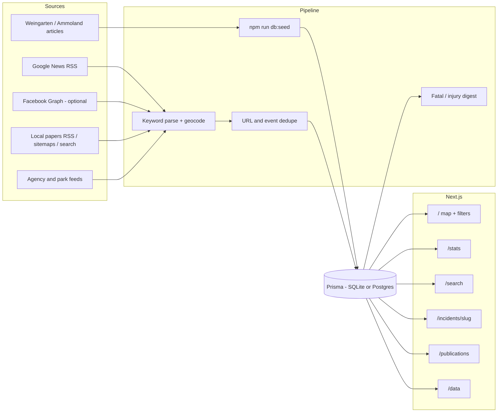
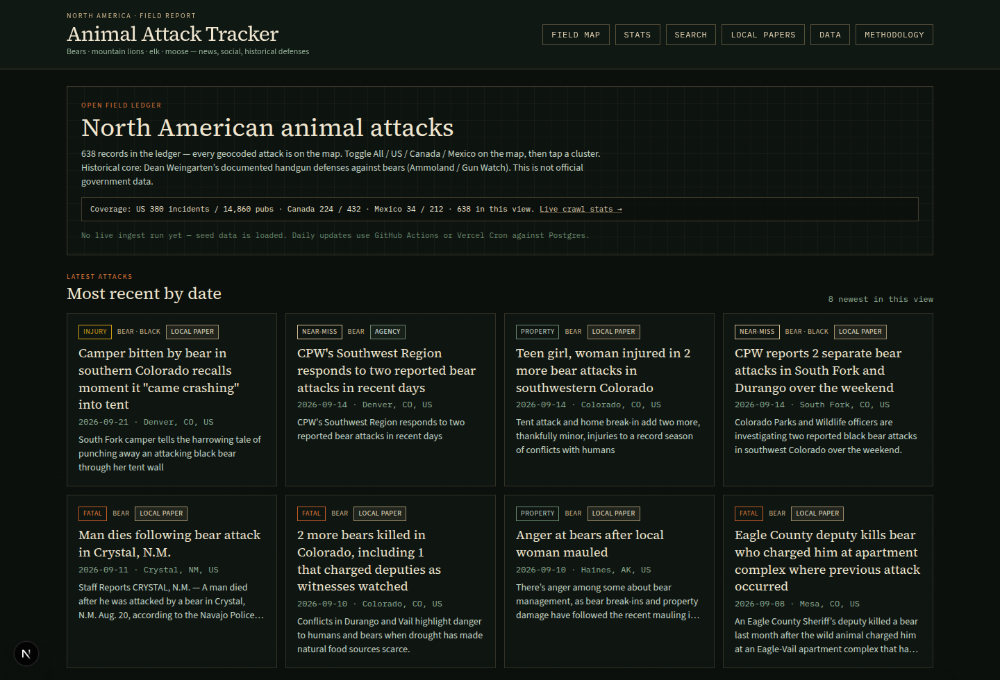
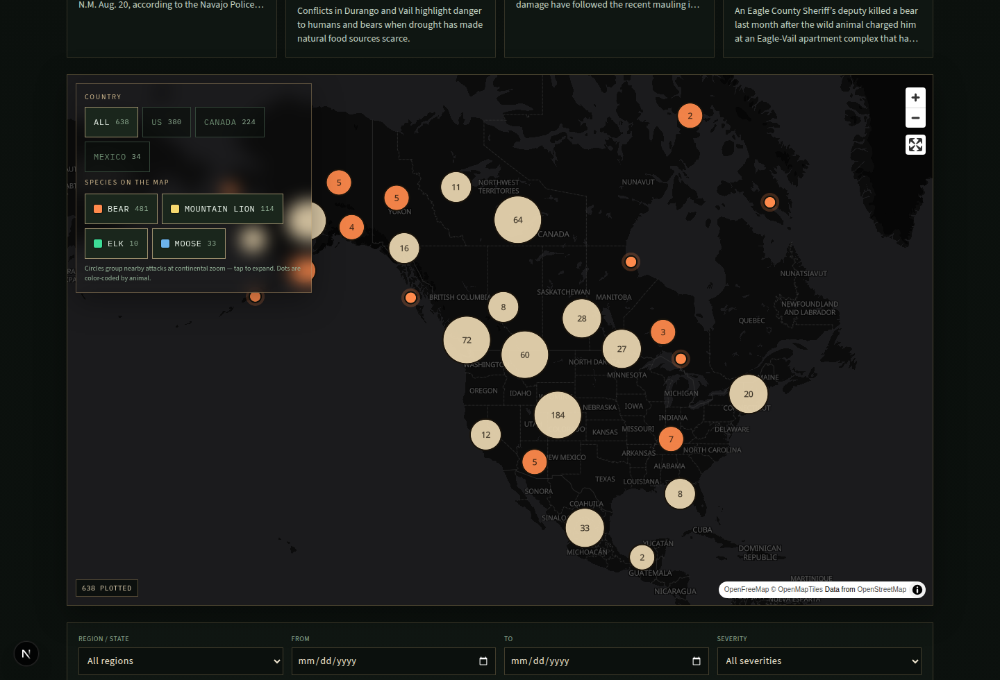
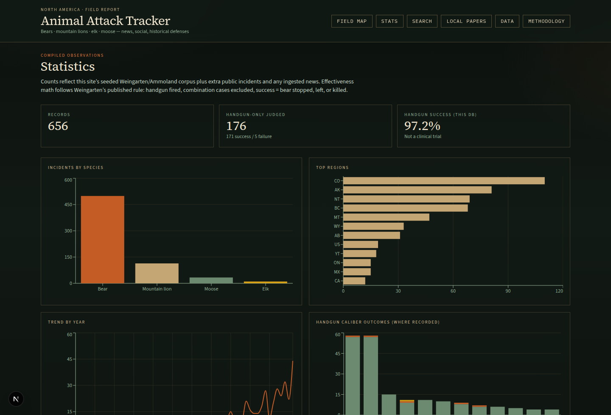
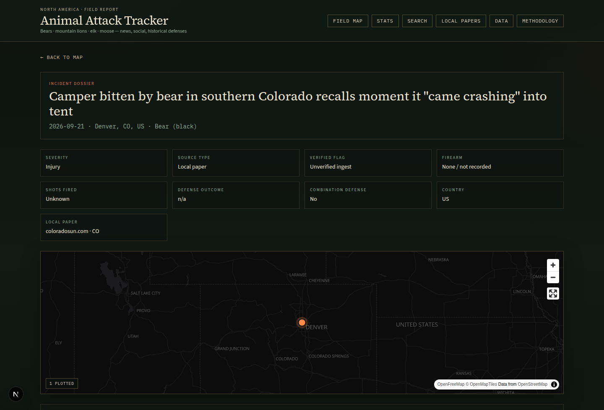
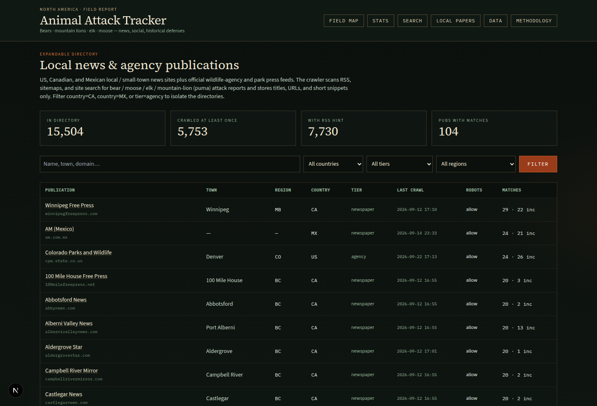
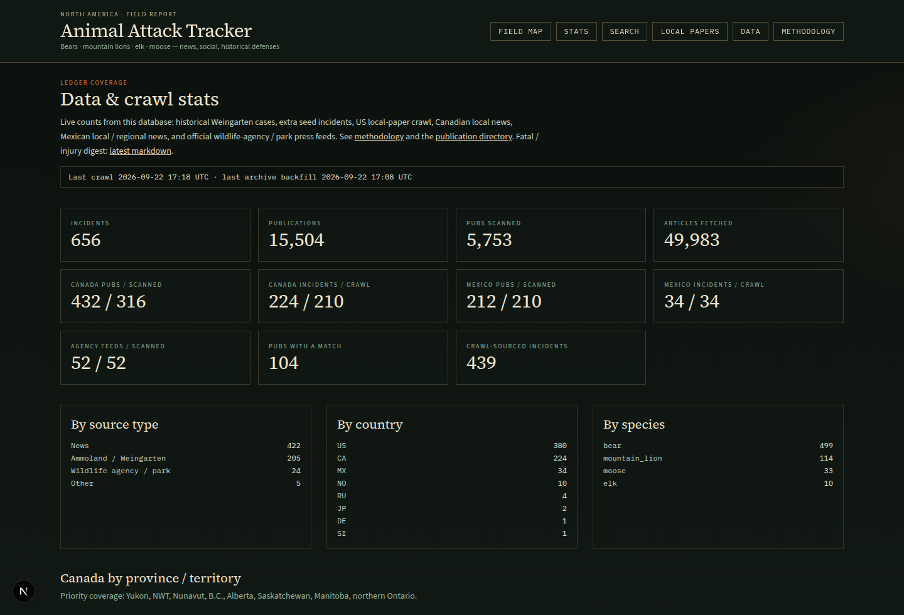

# Animal Attack Tracker

A public Next.js app that compiles **North American animal-attack reports** into a browsable map, list, search, and stats ledger. The focus is **bears, mountain lions (cougars), elk, and moose** across the US, Canada, and Mexico.

Historical starter data comes from Dean Weingarten’s documented handgun defenses against bears, published on [Ammoland](https://www.ammoland.com/) and earlier on [Gun Watch](http://gunwatch.blogspot.com/). Newer rows are ingested from Google News RSS, optional public Facebook pages, official wildlife-agency / park feeds, and a local-newspaper crawler.

This is **not official wildlife-agency data**. Records can be incomplete, duplicated, or wrongly parsed. Do not treat caliber charts as advice to carry or use a firearm.

## Features

- **Incident ledger** — species / subspecies, date, city–region–state/province, country (US / CA / MX), severity (fatal / injury / near-miss / property), summary, source URL(s), source type (news / facebook / ammoland / agency / other), verified flag, lat/lng
- **Defensive-firearm fields** from Weingarten’s research: `firearmType`, `caliber`, `shotsFired`, `defenseOutcome` (success / failure / indeterminate), `combinationDefense`
- **Homepage** — MapLibre map with All / US / Canada / Mexico toggle, latest-attacks feed, and a filterable list (species, region, date, severity, firearm type / caliber) with source badges
- **Shareable filter URLs** and **CSV export** of the filtered ledger
- **Incident detail pages** with attribution
- **Stats** — species, region, yearly trend, and handgun-caliber breakdowns (only where a caliber was extracted)
- **Full-text search**
- **About / methodology** plus a site-wide disclaimer
- **Weekly fatal / injury digest** (`npm run digest` or `/api/digest`) — markdown of new serious incidents since the last run; no email vendor required
- **Daily ingest** — Google News RSS + optional Facebook Graph API (labeled mock if no token)
- **Local / small-town news directory** and a robots-aware progressive crawler that upserts matching incidents

## Tech stack

| Layer | Choice |
| --- | --- |
| App | Next.js 15 App Router, React 19, TypeScript |
| UI | Tailwind CSS, MapLibre GL, Recharts |
| Data | Prisma (SQLite locally; schema is Postgres-ready) |
| Ingest | `rss-parser`, optional OpenAI enrichment, optional Facebook Graph |
| Jobs | GitHub Actions + Vercel Cron |

## Architecture



Protected write paths (`/api/ingest`, `/api/publications/crawl`, authorized digest writes) require `INGEST_SECRET` or `CRON_SECRET` in production. Local development does not.

## Screenshots

Captured from a local `npm run db:seed` run (Weingarten + extra JSON + publication directory + committed crawl progress). Counts on the pages are that seed, not a live production SLA.

**Homepage** — coverage strip and latest-attacks feed:



**Field map** — MapLibre clusters with All / US / Canada / Mexico and species toggles:



**Stats** — species, region, yearly trend, and recorded handgun-caliber outcomes:



**Incident detail** — attribution, fields, and a pinned map:



**Local-paper directory** — 15k+ US / Canada / Mexico / agency rows with crawl status:



**Coverage dashboard** (`/data`):



## Run locally

```bash
npm install
cp .env.example .env   # SQLite default: file:./dev.db
npx prisma db push
npm run parse:weingarten   # optional: rebuild data/weingarten-incidents.json
npm run db:seed
npm run dev
```

Open [http://localhost:3000](http://localhost:3000).

Production (Vercel + hosted Postgres, cron secrets): **[DEPLOY.md](DEPLOY.md)**. Do not treat a GitHub Actions runner’s SQLite file as the production ledger — it disappears when the job ends.

| Environment | `DATABASE_URL` | Prisma provider | Next step |
| --- | --- | --- | --- |
| Local quickstart | `file:./dev.db` | `sqlite` | `npx prisma db push` then `npm run db:seed` |
| Production / daily ingest | hosted `postgresql://…` | `postgresql` | `npx tsx scripts/configure-db-provider.ts`, then `npx prisma db push` once and seed |

`scripts/configure-db-provider.ts` flips the schema to `postgresql` when `DATABASE_URL` starts with `postgres`.

## Data sources

### Historical core (Weingarten / Ammoland)

Public articles are copied under `data/sources/`. `npm run parse:weingarten` extracts dated cases into `data/weingarten-incidents.json` (**206** records in the committed seed). Additional mountain lion / elk / moose rows from public news and agency pages live in `data/extra-incidents.json` (**25** records).

| Article | Role |
| --- | --- |
| [Gun Watch, June 2021](http://gunwatch.blogspot.com/2021/06/using-handguns-or-pistols-in-defense.html) | Last full published list |
| [Ammoland, March 2022](https://www.ammoland.com/2022/03/update-of-pistol-or-handgun-defenses-against-bears/) | Combination (handgun + other lethal tool) cases |
| [Ammoland, April 2022](https://www.ammoland.com/2022/04/update-of-pistol-defenses-against-bears-123-cases-98-effective/) | First handgun-only update |
| [Ammoland, Nov 2023](https://www.ammoland.com/2023/11/handgun-defenses-against-bears-170-documented-incidents-98-effective/) | Second update |
| [Ammoland, May 2024](https://www.ammoland.com/2024/05/bear-defense-with-handguns-update-20-more-cases-98-effective/) | Third update |
| [Ammoland, Oct 2025](https://www.ammoland.com/2025/10/handguns-proven-98-effective-in-205-documented-bear-attacks/) | Fourth update |

Parsing is heuristic. Weingarten’s published **98%** figure uses *his* inclusion rules (handgun actually fired; combination cases excluded from the rate). This site stores combination cases with `combinationDefense=true` and shows caliber breakdowns only where a caliber was extracted. Attribution stays with **Dean Weingarten / Ammoland**.

`npm run geocode:report` prints city-level vs state-centroid vs country-fallback coverage. Known places get city coordinates; otherwise the map uses state/province centroids.

### Publication directory (committed seed)

National Google News still misses a lot of weeklies, so the app ships an expandable publication table (`Publication` in Prisma) and a progressive crawler.

| Seed file | What it is | Count in repo |
| --- | --- | --- |
| `data/publications/us-local-news.json.gz` | Deduped US local outlets | **14,847** unique domains |
| `data/publications/canada-local-news.json` | Curated + Wikidata/Wikipedia Canadian locals | **383** |
| `data/publications/canada-priority-extra.json` | CBC / Radio-Canada / territorial extras | **42** |
| `data/publications/mexico-local-news.json` | Northern + jaguar / black-bear range papers | **199** |
| `data/publications/agency-feeds.json` | Official RSS / newsroom pages | **52** |
| `data/publications/extra.json` | Manual append rows (southern Mexico extras, etc.) | **12** |

Directory rows are **name / URL / place / coordinates** only, merged from open sources and deduped by domain. National wires (NYT, CNN, AP, Facebook, …) are dropped so the table stays local-first.

| Source | What we take | License / ethics |
| --- | --- | --- |
| [3DLNews / WM News Lab](https://github.com/wm-newslab/3DLNews) | US local outlets with website, town, lat/lng, optional RSS | Academic compilation of public directory facts |
| [sTechLab local-news dataset](https://github.com/sTechLab/local-news-dataset) | Local outlets (name, website, city, state) | Cite [Aubin Le Quéré et al., ICWSM 2022](https://mariannealq.com/wp-content/uploads/2022/05/Local_News_ICWSM_Camera_Ready.pdf) |
| [firephil/us-news-sites](https://github.com/firephil/us-news-sites) | Local / regional news domains | Public-domain list |
| [palewire/news-homepages](https://github.com/palewire/news-homepages) | US site roster | Factual names/URLs from a GPL-3.0 archiver |
| [Wikidata](https://query.wikidata.org/) | Newspapers / weeklies / news websites with official websites | CC0 |
| [Wikipedia lists of newspapers by state](https://en.wikipedia.org/wiki/List_of_newspapers_in_the_United_States) | External links from each state list | CC BY-SA — attribute Wikipedia contributors |

Rebuild the US seed with `npm run publications:build`. Append rows in `data/publications/extra.json`. Live session numbers and resume commands: **[RESULTS.md](RESULTS.md)** (a crawl snapshot, not a production SLA).

**Honest gaps:** dead papers and broken URLs remain; some towns never had a site; paywalled weeklies may expose RSS titles but not body (we never bypass paywalls); Wikipedia/Wikidata coverage is uneven. This is not a complete census of every town or an all-time scrape of every site.

## Daily ingest

```bash
npm run ingest          # live: fetch + parse + upsert
npm run ingest:dry      # fetch + parse, no writes; exit 1 on hard failures
# optional flags: --no-facebook  --enrich
```

- **News:** Google News RSS queries for NA bear / cougar / elk / moose attacks
- **Facebook:** `createFacebookFetcher` in `src/lib/ingest/facebook.ts`. If `FACEBOOK_ACCESS_TOKEN` and `FACEBOOK_PAGE_IDS` are set, posts come from Graph API `/{page-id}/posts`. They must pass the same animal+attack keyword matcher as local papers. Otherwise a **labeled mock** path runs so the pipeline stays testable
- **Dedupe:** canonical URL, reprint-farm path collapse, then title + date + place. Cross-URL reprints collapse when the same event shares a distinctive place or a high title overlap
- **Parse:** keyword heuristics + city/state geocode. Set `OPENAI_API_KEY` and pass `--enrich` for optional LLM field cleanup
- **HTTP:** `GET`/`POST /api/ingest` (Bearer `INGEST_SECRET` or `CRON_SECRET`, or `?secret=`). Last runs: `/api/ingest/status`

`.github/workflows/ingest.yml` runs daily at 12:00 UTC. Repo secrets: **`DATABASE_URL`** (required for the scheduled job), optional `OPENAI_API_KEY` and `FACEBOOK_ACCESS_TOKEN` / `FACEBOOK_PAGE_IDS`. `vercel.json` hits `/api/ingest` on the same schedule. Do not put the secret in the cron path.

### Facebook Page-token setup (optional)

This is Graph API access to pages your token is allowed to read — not a scrape of facebook.com.

1. Create a Meta app → Graph API → request `pages_read_engagement` and generate a **long-lived Page token**.
2. Collect numeric Page IDs for public wildlife-agency / park pages you are allowed to read. Suggested slugs: `alaskadfg`, `ColoradoParksandWildlife`, `MTFWP`, `WyomingGameandFish`, `idahofishandgame`, `YellowstoneNPS`, `GlacierNPS`, `RockyNPS`, `ParksCanada`, `BCParks`.
3. Set `FACEBOOK_ACCESS_TOKEN` and `FACEBOOK_PAGE_IDS`. Optional: `FACEBOOK_GRAPH_VERSION=v19.0`, `FACEBOOK_POST_LIMIT=50`.
4. Without those env vars, ingest uses labeled mock posts. `npm run test:facebook` covers mock + a fake Graph fixture.

Rotate the Page token if it leaks. Do not put a user token in production.

## Local newspaper crawler

The crawler prefers RSS/Atom, then sitemaps, then WordPress/site-search archive pages. An **animal term** (bear, moose, elk, mountain lion / cougar / puma — plus Spanish and French variants) **and** an **attack term** must appear in the title or snippet before an incident is created. It stores **title + URL + a ≤400-character snippet** only.

```bash
npm run crawl:publications -- --limit=200
npm run crawl:publications -- --state=MT --since=2018-01-01 --backfill
npm run crawl:canada
npm run crawl:mexico
npm run crawl:agencies
npm run crawl:publications:dry -- --limit=40 --state=AK
```

| Behavior | What it does |
| --- | --- |
| Incremental (default) | RSS + recent sitemap URLs; skips pubs crawled in the last ~18 hours |
| `--backfill` | Deeper sitemaps + site search; skips `lastBackfillAt` so archives can be walked without redoing the RSS pass |
| `--west` / `--wildlife` | Western-core (AK, MT, WY, ID, CO) or the wider wildlife-state set |
| Ethics | Identifies as `animalattacks-tracker/1.0`; honors `robots.txt` including `Crawl-delay`; ≥1.5s between requests to the same host; no paywall bypass; no full-text warehouse |

Browse the directory at `/publications`. Live coverage totals: `/data`. JSON: `GET /api/publications`. Protected crawl trigger: `POST /api/publications/crawl`.

`.github/workflows/crawl-publications.yml` — daily incremental at 13:30 UTC, weekly Sunday backfill, plus manual dispatch.

### Fatal / injury digest

```bash
npm run digest                 # write data/digests/latest.md + a dated file
npm run digest -- --stdout
npm run digest -- --fatal-only --stdout
```

Cursor file: `data/digest-cursor.json`. HTTP: `GET /api/digest` (`?format=md`, `?severity=fatal`). Authorized writes use the same secrets as ingest. Weekly Action: `.github/workflows/digest.yml`.

## Scripts

| Script | Purpose |
| --- | --- |
| `npm run dev` | Next.js dev server |
| `npm run build` | Production build |
| `npm test` | Matcher, dedupe, Facebook, digest, dead-host, landmark checks |
| `npm run db:push` / `db:seed` / `db:reset` | Sync / load / recreate the database |
| `npm run parse:weingarten` | Re-parse `data/sources/` |
| `npm run ingest` / `ingest:dry` | News + Facebook pipeline |
| `npm run publications:build` | Rebuild the US gzipped directory from open sources |
| `npm run crawl:publications` / `crawl:waves` | Scan local papers → upsert incidents |
| `npm run crawl:canada` / `crawl:mexico` / `crawl:cbc` / `crawl:agencies` | Regional / agency crawls |
| `npm run digest` | Weekly fatal / injury markdown |
| `npm run geocode:report` | City / state / country geocode coverage |
| `npm run results:write` | Refresh RESULTS.md + crawl-session-report.json |

More crawl flags and resume notes live in [RESULTS.md](RESULTS.md). Deploy checklist: [DEPLOY.md](DEPLOY.md).

## License and ethics

MIT — see [LICENSE](LICENSE).

Incident text is summarized from public news and Weingarten’s published lists for research/index use. Read the originals. The crawler identifies itself, honors `robots.txt`, rate-limits per host, and is not a full-text newspaper archive.
